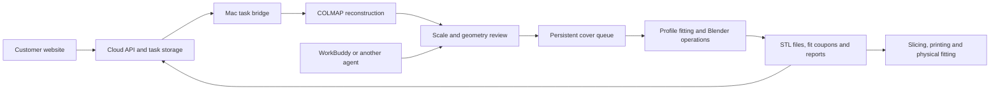

# Forme

*A hackathon project exploring a video-to-prosthetic-cover workflow.*

## Our Technical Journey

We set out to turn a phone video of an existing prosthesis into a personalized, two-part cover that could be fabricated with a 3D printer. The difficult part was recovering geometry that would actually fit: the opening, the body, the lower connector, and the protruding bolt all needed different treatment.

Our route changed through reconstruction experiments, generated models, template fitting, and physical trials. This repository includes both the current implementation and the research scripts behind those decisions.

### 1. Reconstructing the Object from Video

We started with **COLMAP photogrammetry**, using overlapping video frames to recover camera poses and a dense point cloud. A printed target with a known distance between its two circle centers provided the reference for converting reconstruction units into millimeters.

The first challenge was the object itself. Dark surfaces, reflections, plain regions, and the open socket produced incomplete or noisy geometry. A reconstruction could register many cameras while relying heavily on the background. Increasing the point count did not reliably improve the parts that mattered for fitting.

We explored several alternatives:

| Approach | What we learned |
|---|---|
| COLMAP parameter tuning and OpenMVS | Different reconstruction settings could improve coverage, but more surface points did not automatically mean more accurate local geometry. |
| 3D Gaussian Splatting | Useful for inspecting appearance and viewpoints; Gaussian centers were not a reliable contact surface for a fitted cover. |
| Pixal3D and Tencent Hunyuan 3D | Generated meshes offered shape references, but their proportions and details could disagree with the observed object. They could not establish a trustworthy inner cavity. |
| Photo silhouettes and visual hulls | Image contours helped reveal alignment errors and missing regions. Openings and hidden surfaces still needed separate interpretation. |
| CGAL wrapping and smooth envelopes | Envelopes helped bound observed geometry, but smoothing could erase hardware details or close an opening that should remain open. |

These experiments are preserved in [`research/`](research/). They are historical investigations, rather than interchangeable production pipelines.

### 2. Moving from Reconstruction to a Cover

We also tried direct point-cloud lofting, elliptical cross-sections, and template deformation. Each solved part of the problem:

- Simple cross-sections produced clean surfaces but rounded away the object's irregular shape.
- Following every point too closely transferred noise into the cover.
- Small, bounded template adjustments preserved decorative features but could leave most of the cavity incorrectly sized.
- Fixing the template's upper edge prevented visible distortion, but did not make that edge correspond to the real socket opening.

We experimented with **WorkBuddy, DeepSeek, and Blender scripting** to propose and revise geometry. This helped with iteration, but an agent could still generate a plausible-looking mesh with incorrect clearances, disconnected pieces, or a distorted opening.

We therefore separated the agent's role from the geometry engine: the agent prepares evidence, interprets ambiguity, and handles exceptions; repeatable geometric operations run through controlled scripts with explicit checks.

### 3. Physical Fitting Changed the Direction

An early printed version could be placed around the prosthesis in separate halves, but the halves left a large gap when assembled. The rear also bulged outward, while the front did not follow the actual shape.

That feedback exposed a limitation of our digital checks. A watertight STL, a convincing render, or agreement with the same data used to generate the model could not establish physical fit.

We returned to the input data. For the next capture, the object's surface was covered with additional texture to make feature matching more reliable. We rebuilt it from that new video and **excluded Hunyuan from this iteration**.

### 4. The Point-Cloud-Driven Route

The textured capture registered **114 out of 114 frames**, producing approximately **1.71 million dense points**, including about **402,000 cropped subject points**. The user confirmed that the printed calibration target's circle centers were **200 mm apart**.

The revised method combines:

1. **A current-capture scale and rigid coordinate frame.** Crop away the background, estimate the body's axis from multiple sections, and verify orientation against the original cameras.
2. **A symmetric style template.** Start from the two-part `06` ventilated template, with a shared coordinate system for both halves.
3. **Full-height fitting.** Build height-and-angle profiles from the observed outer surface, constrain smoothing with those observations, and apply one deformation field to both halves.
4. **Separate treatment of the opening and hardware.** Trim the top against the observed rim, extend the lower cover along the connector, and create a dedicated bolt clearance instead of smoothing the bolt into a bulge.
5. **Checks on the exported geometry.** Inspect connectedness, watertightness, winding, intersections between halves, bolt-channel clearance, sampled wall thickness, and cross-sections against the cloud.

The final case-specific revision extended the lower edge by **60 mm** and added a **38 mm bolt opening**. Those dimensions belong to that capture; they are not universal defaults for another prosthesis.

The user subsequently reported that the printed **V5 fitted very well**. We recorded that feedback against the exact front and rear STL hashes. It is a successful fitting report for that version, rather than a claim of measured accuracy or validation across multiple users.

### 5. Turning the Experiment into a Repeatable Workflow

We extracted the successful approach from one-off experiment scripts into the [`scanfit` engine](forme-backend/scripts/scanfit/). The operator's main flow is now:

**Start reconstruction → review the current geometry → generate and inspect the STL package.**

After geometry approval, a persistent local queue runs fitting, rim trimming, bolt opening, checks, previews, and packaging. WorkBuddy or another agent can coordinate the task through MCP, the API, or a local CLI using the shared [workflow skill](work-buddy-handoff/skills/forme-scan-workflow/SKILL.md).

Input hashes bind each approval to its video, camera model, calibration, point cloud, review images, and template. Interrupted or failed jobs retain their state instead of publishing partial output. A later software replay of the same capture completed the managed workflow and API downloads; its newly generated files do not inherit the original V5's physical-fitting result.

Our central lesson was that **capture quality, coordinate alignment, and localized geometric evidence mattered more than a visually complete generated model**. Physical feedback helped us decide which parts of the process to automate and which observations still needed review.

## Project Overview

**Forme is a hackathon prototype for designing personalized prosthetic covers from phone video.** It connects a customer-facing design experience, a cloud task service, and a local reconstruction and fabrication workflow.

### What the Prototype Provides

- A customer website with video upload, style and color selection, interactive 3D template previews, and English / Traditional Chinese switching.
- Cloud accounts, persistent submissions, progress tracking, and administrator tools, alongside order and payment-proof review features.
- A local studio for reconstruction, geometric review, and two-part cover generation.
- Millimeter STL files for the front, rear, and combined assembly, plus a local fit coupon, previews, and review reports.
- An agent handoff skill and MCP tools for coordinating the workflow without repeatedly rewriting geometry scripts.

### System Architecture

The cloud handles intake and task history; the Mac handles the local modeling workload. Geometry preparation can be agent-assisted, while uncertain observations and physical dimensions require a real basis. The default scan-first route does not call Hunyuan.

### Technology and Repository Map

| Component | Implementation | Source |
|---|---|---|
| Customer and administrator interfaces | HTML, CSS, JavaScript, 3D previews | [`dist/`](dist/) |
| Cloud service | Python, FastAPI, SQLAlchemy, MySQL | [`cloud/`](cloud/), [`database/`](database/) |
| Local workflow and operator console | Python, FastAPI, SQLite, persistent workers | [`forme-backend/`](forme-backend/) |
| Reconstruction and geometry | COLMAP, NumPy, SciPy, trimesh, Blender | [`scanfit scripts`](forme-backend/scripts/scanfit/) |
| Agent coordination | WorkBuddy MCP, shared skill, local CLI | [`work-buddy-handoff/`](work-buddy-handoff/) |
| Historical exploration | Reconstruction, silhouette, wrapping, and fitting experiments | [`research/`](research/) |

### Validation and Current Scope

The local implementation passed **24 backend tests** and **5 media-loading tests**. A real-data replay exercised the managed generation pipeline and downloads for both halves, the combined STL, and the delivery archive.

The first supported scan-first style is the `06` ventilated template. Other styles appear in the design interface, but their geometry requires separate integration. The fitting evidence currently consists of the user's feedback on one printed V5 case. Printer settings, thin features, fasteners, and fit still need review for each new output. This hackathon prototype has not undergone clinical or broad manufacturing validation.

### Running and Extending the Project

Start with the [complete source handoff](docs/FULL_SOURCE_HANDOFF_ZH.md) and [scan-first workflow guide](forme-backend/SCAN_WORKFLOW_ZH.md), both currently in Chinese. The [agent skill](work-buddy-handoff/skills/forme-scan-workflow/SKILL.md) includes task interfaces, geometry preparation, and recovery procedures. Cloud deployment guidance is in [`deploy/`](deploy/).

The repository contains the application source and the symmetric `06` production template base. Private capture data, databases, API keys, and runtime configuration are excluded. Native reconstruction tools and a geometry Python environment must be configured separately; some workstation scripts retain machine-specific default paths. Deploy only `dist/` as public static files, with the cloud API configured separately. Publishing the static site alone does not enable the modeling workflow.
